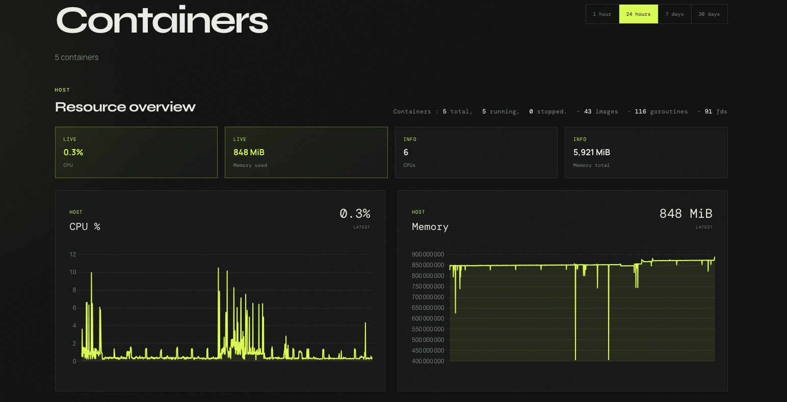

# Metrics

Metrics is a simple, open-source, self-hosted **Docker host monitor**. A dedicated collector reads the Docker Engine API through `docker.sock` and stores CPU/memory time series. The web UI only reads that database. No agents, no project tokens, no push API.



It runs on FrankenPHP (Caddy + PHP in one binary), with **SQLite by default** (low RAM, ideal for self-hosting). PostgreSQL or MySQL work if you point `DATABASE_URL` at your own server — Compose does not ship a database container.

## Features

- Automatic Docker collection (host + containers) on a schedule
- Host-level gauges (container counts, aggregated CPU/RAM)
- Per-container charts (1h / 24h / 7d / 30d)
- Compose grouping via `com.docker.compose.project` / `com.docker.compose.service` labels
- Web login (email/password) to protect the dashboard
- Symfony Scheduler + Messenger collector (ready for FrankenPHP worker mode later)
- Retention pruning for historical points (and orphan GC for removed containers)
- Bounded container log tails (last 500 lines per container by default, collector-synced)

## Requirements

- Docker Engine with Docker Compose v2
- Access to `/var/run/docker.sock` (or `DOCKER_SOCKET`) for the **collector** service

**Security:** mounting `docker.sock` is equivalent to root on the Docker host. Only the collector mounts it. Keep the dashboard behind login and network controls.

## Quick start

Pick one deployment mode. Reverse proxy (Case 2) is the usual self-hosted setup; Case 1 is fine for a quick try on a free host port.

### Case 1 — Standalone (direct Compose)

Compose publishes the dashboard on the host. The port comes from `.env` (`METRICS_PORT`, default **8080**). Change it if something else already uses 8080 (e.g. another stack).

```bash
cp .env.dist .env
# optional: METRICS_PORT=8081 and DEFAULT_URI=http://localhost:8081
docker compose up -d --build
docker compose exec metrics php bin/console app:user:create admin@example.org --password='a-long-secret-passphrase'
```

Open [http://localhost:8080](http://localhost:8080) (or your `METRICS_PORT`). Docker Compose reads `.env` for `${METRICS_PORT}` interpolation; pass `ENV_FILE=.env` if you want the same file injected into the containers instead of `.env.dist`.

### Case 2 — Reverse proxy (Nginx / Traefik / Caddy / NPM)

No host port. The UI is only reachable on the Docker network as **`http://metrics:80`**.

1. `cp .env.dist .env` and set `DEFAULT_URI` to your public URL (e.g. `https://metrics.example.com`).
2. In `compose.yaml` on the `metrics` service:
   - **Comment out** the `ports:` block.
   - **Uncomment** `- proxy-tier` under `networks:`.
3. At the bottom of `compose.yaml`, **uncomment** the `proxy-tier:` external network (rename if your proxy network differs).
4. Point your VHost / Proxy Host at `http://metrics:80`.
5. Start:

```bash
docker compose up -d --build
docker compose exec metrics php bin/console app:user:create admin@example.org --password='a-long-secret-passphrase'
```

Migrations run on `metrics` startup. The `collector` service consumes the schedule every `COLLECTOR_INTERVAL` seconds (default 30).

Force one collection cycle:

```bash
docker compose exec collector php bin/console app:collector:run -v
```

### Environment

```bash
cp .env.dist .env
# Edit APP_SECRET (and METRICS_PORT / DEFAULT_URI), then:
ENV_FILE=.env docker compose up -d --build
```

SQLite data persists in `./var/data` (shared by `metrics` and `collector`). Only the **collector** mounts `docker.sock` read-only.

The collector already runs Scheduler + Messenger (`messenger:consume scheduler_default`). FrankenPHP worker mode is a later optimization to fold that loop into the web process — it is **not** required for automatic collection today.

## Optional PostgreSQL / MySQL

Compose stays SQLite-only on purpose: a bundled Postgres instance wastes ~150 MB RAM at idle for a host monitor. Advanced setups set `DATABASE_URL` to an external database (same network, managed service, etc.):

```bash
# In .env.local
DATABASE_URL="postgresql://user:pass@db:5432/metrics?serverVersion=16&charset=utf8"
# or
DATABASE_URL="mysql://user:pass@db:3306/metrics?serverVersion=8.0"
```

Schema migrations are portable Doctrine Schema API; application queries use standard DQL only.

## Operations

### Health

```bash
# Case 1
curl -fsS "http://localhost:${METRICS_PORT:-8080}/healthz"
# Case 2 (from a container on the proxy network, or via your public URL)
curl -fsS https://metrics.example.com/healthz
docker compose exec metrics wget -qO- http://127.0.0.1/healthz
```

### Retention

Two scheduled jobs run on the `collector` (needs Docker socket for orphan GC):

| When | What |
|------|------|
| **03:00** daily | Historical `data_point` rows older than `METRICS_RETENTION_DAYS` (default **30**) |
| **03:05** daily | `data_state` / `data_point` / `container_log` for containers **removed** from Docker (`?all=1`, so stopped containers are kept) |

Host-level rows (`containerId` null) and the `metric` catalog are never pruned by the orphan job.

Manual run:

```bash
docker compose exec metrics php bin/console app:data-point:prune
# or override:
docker compose exec metrics php bin/console app:data-point:prune --days=7

# Orphans (compare DB vs Docker inventory):
docker compose exec collector php bin/console app:orphan-containers:prune
```

Set `METRICS_RETENTION_DAYS=0` to disable the scheduled age prune only.

### Backup (SQLite)

```bash
docker compose stop metrics collector
cp ./var/data/metrics.sqlite* /path/to/backup/
docker compose start metrics collector
```

### Troubleshooting

```bash
docker compose ps
docker compose logs --tail=200 metrics collector
docker compose exec metrics php bin/console about
```

- Dashboard shows “Cannot reach Docker”: check the socket mount and permissions.
- Empty charts: wait for a collector tick or run `app:collector:run`.

## Local installation without Docker Compose

Still requires a readable Docker socket for the product to be useful:

```bash
cp .env.dist .env.local
composer install
php bin/console doctrine:migrations:migrate --no-interaction
php bin/console app:user:create admin@example.org --password='a-long-secret-passphrase'
php bin/console messenger:consume scheduler_default -vv
# in another terminal:
symfony server:start
```

## Quality and tests

```bash
composer validate --strict
php bin/console lint:container
php bin/console lint:twig templates
vendor/bin/phpunit
vendor/bin/phpstan analyse --no-progress --memory-limit=512M
vendor/bin/php-cs-fixer fix --dry-run --diff
```

## Architecture

```text
docker.sock → collector (Scheduler) → MetricsWriter → Metric / DataPoint
                                                          ↓
                                              metrics dashboard (DB only)
```

- `src/Collector/Docker/`: Engine client, mapper, collector
- `src/Metrics/MetricsWriter.php`: transactional metric + point writes
- `src/Schedule.php` + `CollectMetricsMessage`: recurring collection
- `src/Entity/`: `User`, `Metric`, `DataPoint`, `DataState` (indexed `containerId`)
- `compose.yaml`: FrankenPHP `metrics` (UI) + `collector` (socket); SQLite volume shared

## Security

See [SECURITY.md](SECURITY.md) for deployment guidance and how to report vulnerabilities.

## License

Metrics is distributed under the [MIT License](LICENSE).
